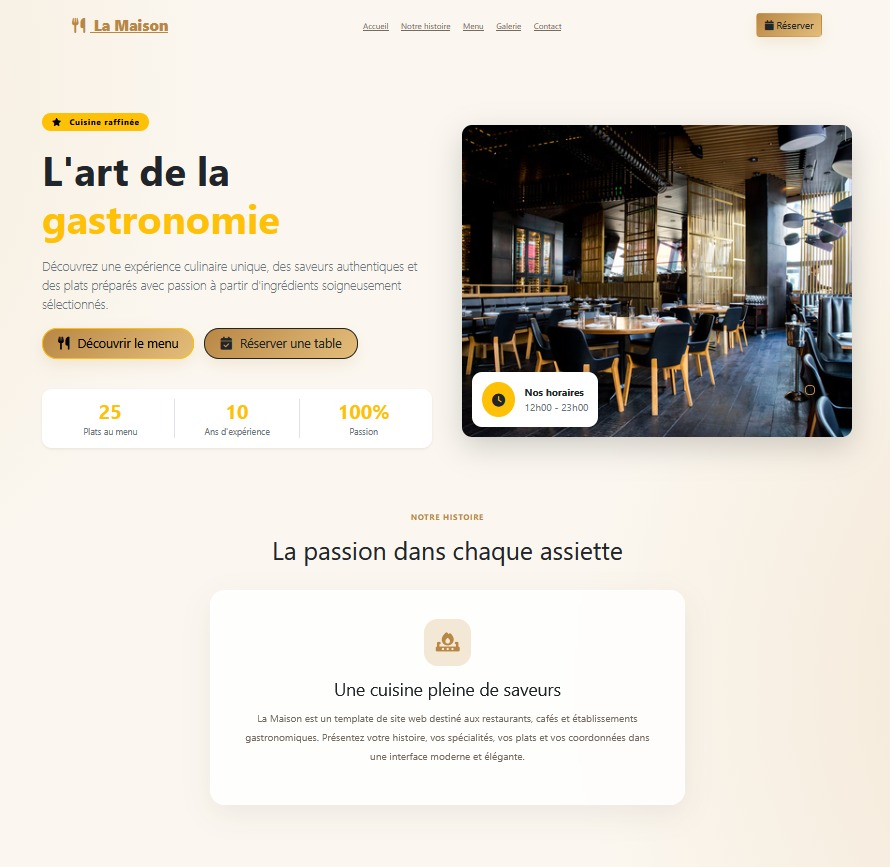
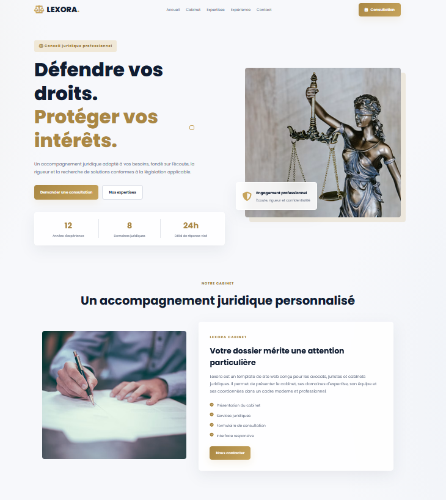
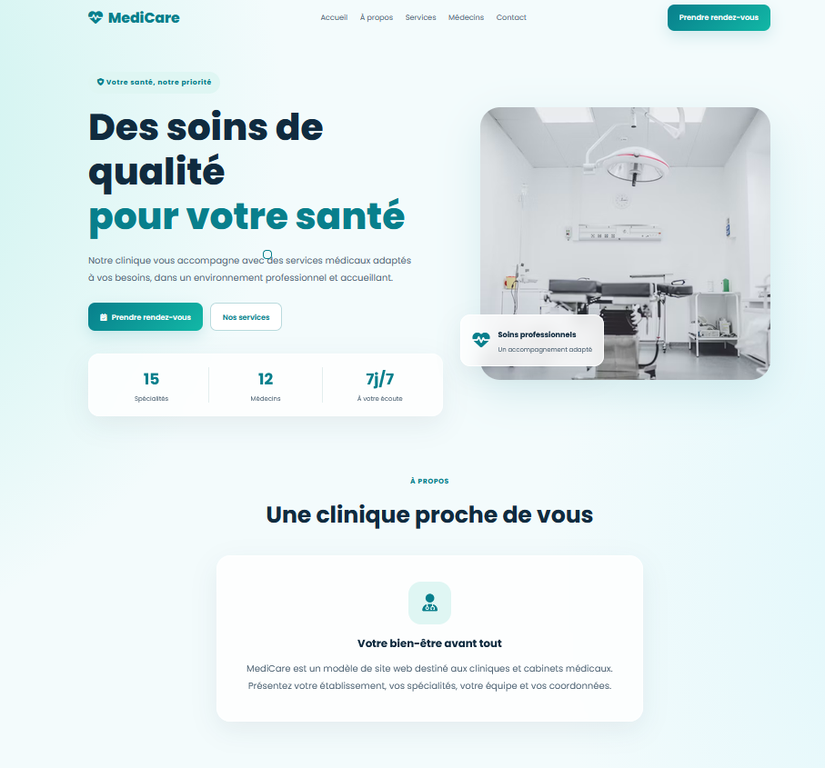

# Web Templates Portfolio

A collection of **six professional and responsive website templates**, designed for different industries and professional portfolios.

Each template has its own visual identity and can be customized to meet the needs of a project or client.

## Screenshots & Previews

Each website template includes preview images to showcase its visual design and layout.

The screenshots are stored in the `images/`    directory and help users explore the appearance of the templates before opening or customizing them.

### Template Previews

| Template | Preview |
|---|---|
| Restaurant |  |
| Lexora |  |
| Medicare |  |
| Influenceur(style sombre) |.png)
| Influencer (style noir et blan) | .png)
| Influenceur(style clair) | .png)


## Templates

### 1. Restaurant
A modern website template for restaurants, cafés, and food businesses. It presents menus, specialties, contact information, and reservation options.

### 2. Lexora
A professional website for lawyers, law firms, and legal consulting services. It highlights practice areas, team information, and contact details.

### 3. Medicare
A healthcare website template for medical clinics and healthcare professionals, featuring medical services, information, and contact sections.

### 4. Influencer
A modern personal branding template for influencers, content creators, and entrepreneurs. It showcases statistics, partnerships, and portfolio content.

### 5. Influencer Noir
An elegant black-and-white website template with a minimalist design, suitable for professional portfolios and personal branding.

### 6. Influencer Mono
A clean and minimalist portfolio template featuring a monochrome visual identity, modern layouts, and responsive sections.

## Technologies

- HTML5
- CSS3
- JavaScript
- Bootstrap
- Font Awesome
- Google Fonts

## Features

- Responsive design for desktop, tablet, and mobile
- Modern and clean user interfaces
- Interactive JavaScript elements
- Customizable content and styling
- Reusable website sections
- Organized CSS and JavaScript files

## Project Structure

```text
web-templates-portfolio/
├── README.md
├── template1.html
├── template2.html
├── template3.html
├── template4.html
├── template5.html
├── template6.html
├── css/
│   ├── template1.css
│   ├── template2.css
│   ├── template3.css
│   ├── template4.css
│   ├── template5.css
│   └── template6.css
└── js/
    ├── template1.js
    ├── template2.js
    ├── template3.js
    ├── template4.js
    ├── template5.js
    └── template6.js
```

## How to Use

1. Clone or download this repository.
2. Open the desired `templateN.html` file in your browser.
3. Customize the HTML, CSS, and JavaScript files to match your needs.

**Note:** Some templates may use external libraries or online resources. An internet connection may be required for those features.

## License

Please define the license and usage terms before distributing or selling these templates.

---

**Developed by Achraf | Web Development**
